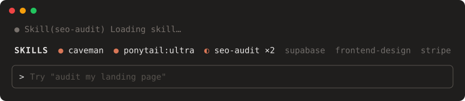

# skills-band

A one-row band above the Claude Code prompt that shows which skills this session has used.



<sub>Preview drawn with the band's real colors and layout: `seo-audit` loaded this turn (spinning), `supabase` last turn, `frontend-design` 2–3 turns ago, `stripe` older.</sub>

- **Every skill counts**: skills typed as `/name`, loaded through the Skill tool, or preloaded into subagents all show up. Plugin skills show their short name (`frontend-design`, not `frontend-design:frontend-design`).
- **Heat**: each skill is colored by how recently it ran. Orange means this turn, amber means last turn, dark amber means 2–3 turns ago, and gray means older. The most recent skills come first. `×N` counts how many times a skill ran.
- **Pulse**: a skill loaded during the current turn spins `◐◓◑◒` while Claude works, then shows `●` when the turn ends.
- **Mode badges** (optional): when the caveman or ponytail plugins are active, their mode shows as a violet badge (`ponytail:ultra`). Without them, the badges stay hidden.

## Install

In Claude Code:

```
/plugin marketplace add codehamster69/skills-band
/plugin install skills-band@rohan-mods
```

Or from a shell:

```bash
claude plugin marketplace add codehamster69/skills-band
claude plugin install skills-band@rohan-mods
```

Restart Claude Code. The band appears above the prompt right away ("no skills used yet") and fills in as skills run. Skills that ran before the restart are not shown.

### Using caveman/ponytail?

The band already shows their badges. If you had a `statusLine` in `~/.claude/settings.json` that only showed those badges, you can remove it to avoid seeing them twice.

## Update / remove

```bash
claude plugin update skills-band@rohan-mods
claude plugin uninstall skills-band@rohan-mods
```

## Requirements

- A Claude Code build that supports mods (`hooks/hooks.json` with `modules`).
- A font with `◐◓◑◒●` (the Windows Terminal, iTerm2 and most Linux defaults have them).
- Hex background colors, which need a truecolor terminal.

## Develop

```bash
claude plugin validate .
claude plugin test .
```

Colors are constants at the top of `hooks/register.tsx` (`HEADER`, `ALWAYS_BG`, `HEAT`).

## License

MIT
